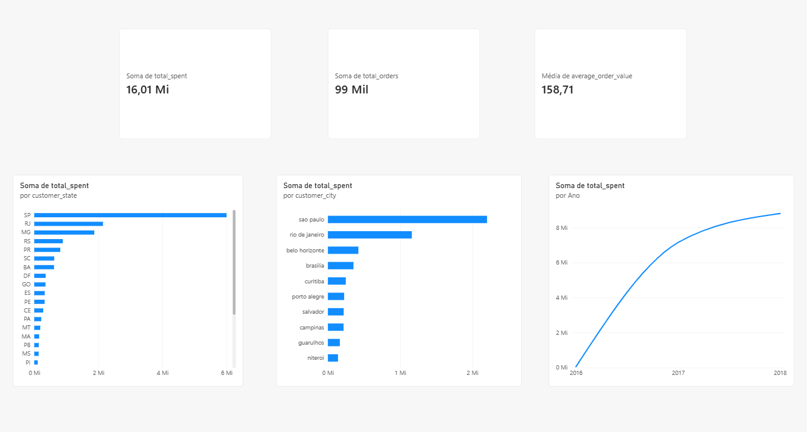

# 🐾 Petflow: E-Commerce Customer Analytics & Pipeline ELT

[](https://www.python.org/)
[](https://www.postgresql.org/)
[](https://www.docker.com/)
[](https://powerbi.microsoft.com/)

O **Petflow** é um projeto end-to-end de Engenharia e Análise de Dados voltado para o setor de e-commerce. O objetivo principal é estruturar uma pipeline robusta de ELT (Extract, Load, Transform), consolidar dados operacionais em um **Data Warehouse** no PostgreSQL via containerização Docker, e entregar um dashboard executivo no Power BI com métricas chave de vendas e comportamento de clientes.

---

## 📊 Dashboard Executivo



O painel reúne as principais métricas de desempenho e comportamento de compra dos clientes:

* **Receita Total:** R$ 16,01 Mi
* **Total de Pedidos:** 99 mil
* **Ticket Médio:** R$ 158,71
* **Vendas por Estado:** Distribuição geográfica com destaque para SP, RJ e MG.
* **Top 10 Cidades:** Principais municípios em volume financeiro.
* **Evolução Temporal:** Curva de crescimento das vendas entre 2016 e 2018.

---

## 🏗️ Arquitetura do Projeto

O projeto é dividido em três camadas de dados dentro do PostgreSQL:

1. **`staging`**: Tabela de entrada dos dados brutos consumidos diretamente dos arquivos CSV (~96 mil registros).
2. **`warehouse`**: Modelagem dimensional com tabelas fato (`fact_order`) e dimensões (`dim_customer`, `dim_product`).
3. **`analytics`**: Camada final com a view `customer_analytics`, preparada para consulta direta pelo Power BI.

```
CSV Raw -> Python (Ingestão) -> Postgres [staging] -> SQL [warehouse] -> SQL [analytics] -> Power BI
```

---

## 🛠️ Tecnologias Utilizadas

* **Linguagem**: Python 3.11+
* **Banco de Dados**: PostgreSQL 15
* **Infraestrutura**: Docker & Docker Compose
* **Manipulação e Ingestão**: `pandas`, `sqlalchemy`, `psycopg2`
* **Visualização de Dados**: Power BI Desktop

---

## 📁 Estrutura do Repositório

```text
petflow/
├── data/
│   ├── raw/                # Dados brutos em CSV (Ignorados pelo Git)
│   └── processed/          # Arquivos auxiliares processados
├── sql/
│   └── analytics/
│       ├── 01_create_schemas.sql
│       ├── 02_create_staging_tables.sql
│       ├── 03_create_warehouse.sql
│       └── 04_build_customer_analytics.sql
├── src/
│   ├── ingestion/
│   │   └── load_staging.py # Script Python para carga inicial em staging
│   ├── transformation/     # Scripts de modelagem SQL/Python
│   └── warehouse/
├── docker-compose.yml       # Configuração do serviço PostgreSQL
├── Dockerfile              # Imagem personalizada para o ambiente
├── requirements.txt
├── .gitignore
└── README.md
```

---

## 🚀 Como Executar

1. **Subir o banco de dados via Docker:**
   ```bash
   docker-compose up -d
   ```

2. **Instalar as dependências do Python:**
   ```bash
   python -m venv .venv
   source .venv/bin/activate  # Ou .\.venv\Scripts\Activate no Windows
   pip install -r requirements.txt
   ```

3. **Executar a carga inicial:**
   ```bash
   python src/ingestion/load_staging.py
   ```

4. **Rodar os scripts de transformação SQL:**
   Executar os scripts contidos na pasta `sql/analytics/` na ordem numérica para criar as camadas `warehouse` e `analytics`.

---

## 👤 Autora

Desenvolvido por **Ana Julia Dias**.  
[GitHub](https://github.com/naju-dias) | [LinkedIn](https://www.linkedin.com)
